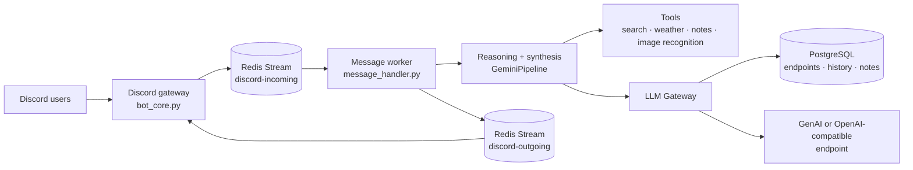

<div align="center">


<p>
  <a href="README.vi.md">Tiếng Việt</a> ·
  <a href="docs/architecture.md">Architecture</a> ·
  <a href="docs/endpoint_and_models.md">Endpoint Guide</a> ·
  <a href="docs/operations.md">Operations</a>
</p>

<p>
  
  
  
  
  
  
  
</p>

<p><strong>A reliable, endpoint-first AI assistant for Discord.</strong><br />
Multi-step reasoning, tool calling, long-term memory, multimodal input, voice-room utilities, and containerized infrastructure in one focused bot.</p>

</div>

## Overview

Azuris is an event-driven Discord AI assistant built around PostgreSQL, Redis Streams, and configurable LLM endpoints. It supports Google GenAI-compatible and OpenAI-compatible providers without hard-coding a provider-specific key pool into the application.

The standard runtime is **Docker Compose**: one single-replica bot, PostgreSQL 16, and Redis 7. All persistent data lives **outside** the image — bot files in relative host folders (`./data`, `./uploaded_files`, `./logs`), database content in the `./data/postgres` host folder plus a portable SQL seed (`./data/db_seed/azuris.sql`) — so cloning the repo to another machine (Windows or Linux) reproduces the same database instead of starting empty.

## Why Azuris

| Capability | What it provides |
| --- | --- |
| 🧠 Reasoning pipeline | Separate reasoning and final-synthesis stages with bounded retries and deadlines |
| 🧰 Tool calling | Web search, WeatherAPI.com weather, calculator, notes, role management, and image recognition |
| 🔌 Endpoint-first LLM | Configure SDK, URL, API key, and three model slots from Discord with /endpoint |
| 🖼️ Multimodal | Process image attachments with the active model's native image understanding |
| 🧾 Long-term memory | User-scoped notes, JSONB metadata, global-fact promotion, and file notes |
| 🔊 Voice rooms | Lock rooms, manage allowlists, move members, and apply room policies |
| 🛡️ Safety controls | Secret scanning, URL validation, user isolation, role checks, and sanitized errors |
| 🐳 Portable runtime | Single `docker compose up`, data in relative host paths, DB seed file for clones |

## Architecture

Discord → Redis Streams → worker → LLM/tools → PostgreSQL → Redis → Discord



For the detailed module map and data flow, see [docs/architecture.md](docs/architecture.md).

## Quick Start (Docker — standard)

### Requirements

- Docker Desktop (Windows/macOS) or Docker Engine + Compose plugin (Linux)
- A Discord bot token
- At least one configured LLM endpoint (after first start, via `/endpoint config`)

### Run

```powershell
Copy-Item .env.example .env
# Edit .env: DISCORD_TOKEN, ADMIN_IDS, AZURIS_DB_PASSWORD (URL-safe [A-Za-z0-9_-]), DONATE_ENCRYPTION_KEY...

docker compose up -d --build
docker compose logs -f bot
```

Check health: `docker compose ps` — all three services should be `healthy`, and the bot log ends with `is online and ready!`.

Stop: `docker compose down` (keeps data). Full reset (reseeds DB from file): stop the stack, empty `data/postgres`, then `up` again.

### Where the data lives

| Inside container | Actually stored at (host, relative paths) | Notes |
| --- | --- | --- |
| `/app/data`, `/app/uploaded_files`, `/app/logs` | `./data`, `./uploaded_files`, `./logs` | Bind mounts — visible on host, never inside the image |
| `/app/assets/encrypted` | `./assets/encrypted` | Read-only bind mount (donate QR) |
| PostgreSQL data dir | `./data/postgres` (bind) + `./data/db_seed/azuris.sql` | Seed file restores the full DB on first init of an empty folder |

To refresh the seed from a running stack:

```powershell
docker compose exec -T postgres pg_dump -U azuris -d azuris --no-owner --no-privileges --clean --if-exists -F p -f /tmp/seed.sql
docker cp azuris-postgres-1:/tmp/seed.sql data/db_seed/azuris.sql
```

### Container image (GHCR) & deploy elsewhere

CI builds the bot image on every push to `main` and on `v*` tags, scans it with Trivy (blocks on fixable CRITICAL/HIGH), and pushes to `ghcr.io/<owner>/<repo>` (`:latest`, `:<short-sha>`, `:vX.Y.Z`). PRs build + scan without pushing. No Docker Hub needed — GHCR has no pull rate limits for your own images and reuses GitHub auth.

Deploy on another machine (Linux/Windows):

```bash
cp .env.example .env   # fill DISCORD_TOKEN, ADMIN_IDS, AZURIS_DB_PASSWORD, ...
# add: BOT_IMAGE=ghcr.io/<owner>/<repo>:latest
docker compose pull
docker compose up -d
```

First start restores the full DB from `data/db_seed/azuris.sql`. If the package is private, `docker login ghcr.io` first (or set the package to public).

### One-button runner

`run_bot.ps1` (Windows) / `run_bot.sh` (Linux) is the single entry point — everything runs inside Docker. Run with no arguments (or right-click → Run with PowerShell) for an interactive menu; pass a command directly to skip it:

```powershell
.\run_bot.ps1              # build (if needed) + start all
.\run_bot.ps1 stop-bot     # stop only the bot, keep postgres/redis running
.\run_bot.ps1 stop-infra   # stop only infra, containers and data kept
.\run_bot.ps1 logs         # follow bot logs
.\run_bot.ps1 ps           # status + RAM usage per service
```

Full command list: `up|down|stop-bot|stop-infra|rebuild|restart|logs [svc]|ps|seed|backup|update`. `down` stops everything but keeps data; emptying `data/postgres` + `up` reseeds the DB from file.

### Legacy local run (removed)

The legacy direct runner and the portable `src/.runtime` (PostgreSQL + Redis binaries, ~1GB) were removed — see [docs/deprecated.md](docs/deprecated.md). Docker is the only runtime.

## Configuration

Copy [.env.example](.env.example) to .env. Never commit .env or paste it into issues, pull requests, or chat.

Minimum configuration:

```env
DISCORD_TOKEN=your-discord-bot-token
ADMIN_IDS=your-discord-user-id
AZURIS_DB_USER=azuris
AZURIS_DB_PASSWORD=url-safe-password-for-docker-postgres
AZURIS_DB_NAME=azuris
DONATE_ENCRYPTION_KEY=your-fernet-key
WEATHER_API_KEY=your-weatherapi-key
```

Inside Compose, `DATABASE_URL`/`REDIS_URL` are overridden to point at the `postgres`/`redis` services — the values in `.env` only matter for legacy local runs.

Generate a Fernet key with:

```bash
python -c "from cryptography.fernet import Fernet; print(Fernet.generate_key().decode())"
```

Endpoint API keys are encrypted before being stored in PostgreSQL. Plaintext endpoint-key storage is disabled by default; only enable ALLOW_PLAINTEXT_ENDPOINT_KEYS=true for an explicitly accepted local-development risk.

## LLM Endpoints

Azuris stores both provider configurations in PostgreSQL and activates one SDK at a time. Each endpoint has three model slots:

| Slot | Purpose | Fallback rule |
| --- | --- | --- |
| reasoning | Tool-aware reasoning loop | Falls back to final |
| final | User-facing synthesis | First available model |
| fallback | Same-provider retry model | Falls back to reasoning, then final |
Configure from Discord:

```text
/endpoint config
/endpoint view
/endpoint models
/endpoint test
/endpoint switch
```

For a local router_api:

```text
GenAI-compatible:  http://127.0.0.1:58100
OpenAI-compatible: http://127.0.0.1:58100/v1
```

Loopback is supported for local routers. Link-local, cloud-metadata, and unsafe private-network targets are blocked by default; see ALLOW_PRIVATE_ENDPOINT_HOSTS for an explicit trusted-LAN exception. Full details are in [docs/endpoint_and_models.md](docs/endpoint_and_models.md).

**Linux note:** from inside the bot container, `127.0.0.1` is the container itself, not your host. Point the endpoint at the router's LAN address or add it to the Compose network.

## Discord Commands

| Area | Commands |
| --- | --- |
| 🔧 Administration | /endpoint, /health_check, /moderator, /premium, /reset-all, /global-notes |
| 💬 Assistant | /ping, /reset-chat, /imagine, /donate |
| 🔊 Voice rooms | /lock, /unlock, /locklist, /allow, /allowremove, /allowlist, /move, /move_all, /set_room |

Permissions are enforced through static admin/moderator configuration and database-backed roles. Voice-room commands use owner/allowlist checks.

## Testing

```bash
python -m pytest -q
python -m compileall -q src scripts tests
```

The CI workflow runs compilation, PostgreSQL/Redis-backed tests, and the secret scan on every pull request.

## Security Notes

- Keep .env, database credentials, Discord tokens, API keys, and Fernet keys private.
- Rotate credentials immediately if the project directory or logs were shared.
- Use a dedicated Discord bot with only the permissions it needs.
- Keep DONATE_ENCRYPTION_KEY stable after endpoint keys have been stored; changing it requires re-encrypting stored keys.
- Review docs/incidents.md before changing runtime, Redis, or pipeline behavior.
- Run python scripts/scan_secrets.py --git before publishing a branch.

## Documentation

- [docs/architecture.md](docs/architecture.md) — system design and data flow
- [docs/configuration.md](docs/configuration.md) — environment variables and database schema
- [docs/endpoint_and_models.md](docs/endpoint_and_models.md) — endpoint and model-slot behavior
- [docs/operations.md](docs/operations.md) — installation, operations, logs, and troubleshooting
- [docs/deprecated.md](docs/deprecated.md) — removed and deprecated features
- [README.vi.md](README.vi.md) — Vietnamese documentation

## Contributing

1. Create a focused branch from main.
2. Add or update tests in tests/.
3. Run the local test and compile commands.
4. Open a pull request and wait for CI and secret-scan checks.
5. Merge only after all required checks pass.

## License

See [LICENSE](LICENSE).
