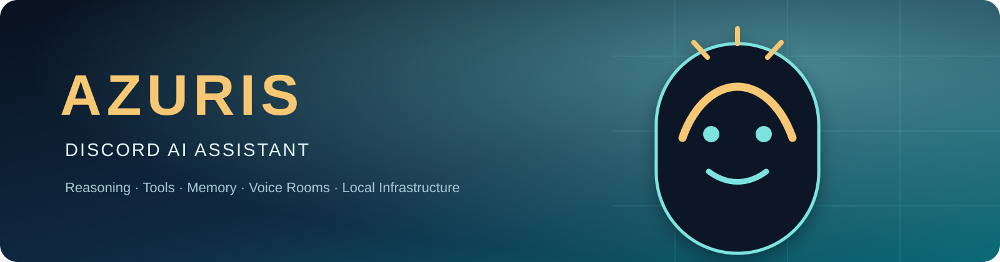
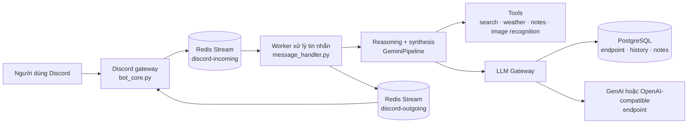

<div align="center">



<p>
  <a href="README.md">English</a> ·
  <a href="docs/architecture.md">Kiến trúc</a> ·
  <a href="docs/endpoint_and_models.md">Endpoint</a> ·
  <a href="docs/operations.md">Vận hành</a>
</p>

<p>
  
  
  
  
  
  
</p>

<p><strong>Trợ lý AI Discord đáng tin cậy, ưu tiên endpoint và tự lưu trữ.</strong><br />
Reasoning đa bước, tool calling, memory dài hạn, xử lý ảnh, tiện ích voice room và hạ tầng local trong một bot duy nhất.</p>

</div>

## Tổng quan

Azuris là trợ lý AI cho Discord được xây dựng theo kiến trúc hướng sự kiện, kết hợp PostgreSQL, Redis Streams và các LLM endpoint có thể cấu hình. Bot hỗ trợ provider tương thích Google GenAI và OpenAI mà không hard-code pool API key vào ứng dụng.

Dự án hướng tới self-host trên Windows hoặc Linux. PostgreSQL và Redis có thể chạy trong local runtime của repository nên không bắt buộc phải cài Docker.

## Điểm nổi bật

| Năng lực | Mô tả |
| --- | --- |
| 🧠 Reasoning pipeline | Tách reasoning và final synthesis, có retry, timeout và giới hạn vòng lặp |
| 🧰 Tool calling | Web search, thời tiết WeatherAPI.com, calculator, notes, quản lý role và nhận diện ảnh |
| 🔌 LLM endpoint-first | Cấu hình SDK, URL, API key và ba model slot bằng /endpoint trên Discord |
| 🖼️ Multimodal | Xử lý ảnh đính kèm bằng khả năng đọc ảnh native của model active |
| 🧾 Long-term memory | Note theo user, metadata JSONB, global fact promotion và file notes |
| 🔊 Voice rooms | Khóa phòng, allowlist, di chuyển thành viên và áp dụng chính sách phòng |
| 🛡️ An toàn | Quét secret, kiểm tra URL, cô lập dữ liệu, kiểm tra role và ẩn lỗi nội bộ |
| ⚡ Ổn định | Redis event flow, tuần tự theo user, giới hạn concurrency và deadline cho LLM |

## Kiến trúc

Luồng chính:

`Discord → Redis Streams → worker → LLM/tools → PostgreSQL → Redis → Discord`



Xem bản đồ module và data flow đầy đủ tại [docs/architecture.md](docs/architecture.md).

## Cài đặt nhanh

### Yêu cầu

- Python 3.10 trở lên
- Windows 10/11 hoặc Linux
- Discord bot token
- PostgreSQL 16 và Redis, chạy local hoặc bên ngoài
- Ít nhất một LLM endpoint đã cấu hình

### Windows

```powershell
python -m venv .venv
.\\.venv\\Scripts\\Activate.ps1
python -m pip install -r requirements.txt

powershell -ExecutionPolicy Bypass -File .\\install_services.ps1
Copy-Item .env.example .env
# Mở .env và điền các secret cần thiết.

powershell .\\run_bot.ps1 --preflight-only
powershell .\\run_bot.ps1 --server
```

Dừng bot và hạ tầng local:

```powershell
powershell .\\stop_bot.ps1
powershell .\\stop_infra.ps1
```

### Linux

```bash
python3 -m venv .venv
source .venv/bin/activate
python -m pip install --upgrade pip
python -m pip install -r requirements.txt

chmod +x install_services.sh run_bot.sh stop_infra.sh
./install_services.sh
cp .env.example .env
# Mở .env và điền các secret cần thiết.

./run_bot.sh --preflight-only
./run_bot.sh --pm2 --server
```

## Cấu hình

Copy .env.example thành .env. Tuyệt đối không commit .env hoặc gửi nó vào issue, pull request hay chat.

Cấu hình tối thiểu:

```env
DISCORD_TOKEN=your-discord-bot-token
ADMIN_IDS=your-discord-user-id
DATABASE_URL=postgresql://azuris@127.0.0.1:55432/azuris
REDIS_URL=redis://127.0.0.1:6379/0
DONATE_ENCRYPTION_KEY=your-fernet-key
WEATHER_API_KEY=your-weatherapi-key
```

Tạo Fernet key:

```bash
python -c "from cryptography.fernet import Fernet; print(Fernet.generate_key().decode())"
```

API key của endpoint được mã hóa trước khi lưu vào PostgreSQL. Mặc định hệ thống từ chối lưu plaintext; chỉ bật ALLOW_PLAINTEXT_ENDPOINT_KEYS=true khi đã chấp nhận rõ rủi ro trong môi trường local.

## LLM Endpoint

Azuris lưu cả hai cấu hình provider trong PostgreSQL nhưng chỉ active một SDK tại một thời điểm. Mỗi endpoint có ba model slot:

| Slot | Vai trò | Quy tắc fallback |
| --- | --- | --- |
| reasoning | Vòng reasoning có tool | Fallback về final |
| final | Tổng hợp câu trả lời | Model đầu tiên khả dụng |
| fallback | Model retry cùng provider | Fallback về reasoning, rồi final |
Cấu hình từ Discord:

```text
/endpoint config
/endpoint view
/endpoint models
/endpoint test
/endpoint switch
```

Với router_api local:

```text
GenAI-compatible:  http://127.0.0.1:58100
OpenAI-compatible: http://127.0.0.1:58100/v1
```

Loopback được cho phép để dùng router local. Link-local, cloud metadata và các đích private-network không an toàn bị chặn mặc định; xem ALLOW_PRIVATE_ENDPOINT_HOSTS nếu cần cho phép LAN tin cậy. Chi tiết tại [docs/endpoint_and_models.md](docs/endpoint_and_models.md).

## Các lệnh Discord

| Nhóm | Lệnh |
| --- | --- |
| 🔧 Quản trị | /endpoint, /health_check, /moderator, /premium, /reset-all, /global-notes |
| 💬 Trợ lý | /ping, /reset-chat, /imagine, /donate |
| 🔊 Voice room | /lock, /unlock, /locklist, /allow, /allowremove, /allowlist, /move, /move_all, /set_room |

Quyền được kiểm soát bằng cấu hình admin/moderator tĩnh kết hợp role trong database. Lệnh voice room dùng kiểm tra owner/allowlist.

## Kiểm thử

```bash
python -m pytest -q
python -m compileall -q src scripts tests
```

CI chạy compile, test với PostgreSQL/Redis và secret scan cho mỗi pull request. Bộ test hiện tại có 171 test pass.

## Lưu ý bảo mật

- Giữ kín .env, thông tin database, Discord token, API key và Fernet key.
- Đổi credential ngay nếu thư mục dự án hoặc log từng bị chia sẻ.
- Dùng Discord bot riêng với quyền tối thiểu cần thiết.
- Giữ ổn định DONATE_ENCRYPTION_KEY sau khi đã lưu endpoint; đổi key cần mã hóa lại các key trong database.
- Đọc [docs/incidents.md](docs/incidents.md) trước khi sửa runtime, Redis hoặc pipeline.
- Chạy python scripts/scan_secrets.py --git trước khi public branch.

## Tài liệu

- [docs/architecture.md](docs/architecture.md) — kiến trúc và data flow
- [docs/configuration.md](docs/configuration.md) — biến môi trường và database schema
- [docs/endpoint_and_models.md](docs/endpoint_and_models.md) — endpoint và model slot
- [docs/operations.md](docs/operations.md) — cài đặt, vận hành, log và troubleshooting
- [docs/deprecated.md](docs/deprecated.md) — tính năng đã gỡ/deprecated
- [README.md](README.md) — tài liệu tiếng Anh

## Đóng góp

1. Tạo branch riêng từ main.
2. Test mới hoặc test cập nhật đặt trong tests/.
3. Chạy test và compile trước khi mở PR.
4. Chờ CI và secret scan hoàn tất.
5. Chỉ merge khi tất cả check bắt buộc đều pass.

## Giấy phép

Xem [LICENSE](LICENSE).

