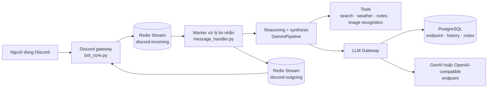

<div align="center">


<p>
  <a href="README.md">English</a> ·
  <a href="docs/architecture.md">Kiến trúc</a> ·
  <a href="docs/endpoint_and_models.md">Endpoint</a> ·
  <a href="docs/operations.md">Vận hành</a>
</p>

<p>
  
  
  
  
  
  
  
</p>

<p><strong>Trợ lý AI Discord đáng tin cậy, ưu tiên endpoint và tự lưu trữ.</strong><br />
Reasoning đa bước, tool calling, memory dài hạn, xử lý ảnh, tiện ích voice room và hạ tầng local trong một bot duy nhất.</p>

</div>

## Tổng quan

Azuris là trợ lý AI cho Discord được xây dựng theo kiến trúc hướng sự kiện, kết hợp PostgreSQL, Redis Streams và các LLM endpoint có thể cấu hình. Bot hỗ trợ provider tương thích Google GenAI và OpenAI mà không hard-code pool API key vào ứng dụng.

Dự án chạy chuẩn bằng **Docker Compose**: một bot duy nhất, PostgreSQL 16 và Redis 7. Mọi dữ liệu persistent đều nằm **ngoài** image — file bot trong thư mục host tương đối (`./data`, `./uploaded_files`, `./logs`), nội dung database trong folder host `./data/postgres` kèm file seed portable (`./data/db_seed/azuris.sql`) — nên clone repo sang máy khác (Windows hay Linux) vẫn ra đúng database cũ thay vì database trống.

## Điểm nổi bật

| Năng lực | Mô tả |
| --- | --- |
| 🧠 Reasoning pipeline | Tách reasoning và final synthesis, có retry, timeout và giới hạn vòng lặp |
| 🧰 Tool calling | Web search, thời tiết WeatherAPI.com, calculator, notes, quản lý role và nhận diện ảnh |
| 🔌 LLM endpoint-first | Cấu hình SDK, URL, API key và ba model slot bằng /endpoint trên Discord |
| 🖼️ Multimodal | Xử lý ảnh đính kèm bằng khả năng đọc ảnh native của model active |
| 🧾 Long-term memory | Note theo user, metadata JSONB, global fact promotion và file notes |
| 🔊 Voice rooms | Khóa phòng, allowlist, di chuyển thành viên và áp dụng chính sách phòng |
| 🛡️ An toàn | Quét secret, kiểm tra URL, cô lập dữ liệu, kiểm tra role và ẩn lỗi nội bộ |
| ⚡ Ổn định | Redis event flow, tuần tự theo user, giới hạn concurrency và deadline cho LLM |

## Kiến trúc

Luồng chính:

`Discord → Redis Streams → worker → LLM/tools → PostgreSQL → Redis → Discord`



Xem bản đồ module và data flow đầy đủ tại [docs/architecture.md](docs/architecture.md).

## Cài đặt nhanh (Docker — chuẩn)

### Yêu cầu

- Docker Desktop (Windows/macOS) hoặc Docker Engine + Compose plugin (Linux)
- Discord bot token
- Ít nhất một LLM endpoint (cấu hình sau lần start đầu bằng `/endpoint config`)

### Chạy

```powershell
Copy-Item .env.example .env
# Mở .env: điền DISCORD_TOKEN, ADMIN_IDS, AZURIS_DB_PASSWORD (ký tự URL-safe [A-Za-z0-9_-]), DONATE_ENCRYPTION_KEY...

docker compose up -d --build
docker compose logs -f bot
```

Kiểm tra: `docker compose ps` — cả ba service phải `healthy`, log bot kết thúc bằng `is online and ready!`.

Dừng: `docker compose down` (giữ data). Reset toàn bộ (seed lại DB từ file): tắt stack, xóa nội dung `data/postgres`, rồi `up` lại.

### Data nằm ở đâu

| Trong container | Thực tế (host, đường dẫn tương đối) | Ghi chú |
| --- | --- | --- |
| `/app/data`, `/app/uploaded_files`, `/app/logs` | `./data`, `./uploaded_files`, `./logs` | Bind mount — nhìn thấy trên host, không vào image |
| `/app/assets/encrypted` | `./assets/encrypted` | Mount read-only (QR donate) |
| Thư mục data PostgreSQL | `./data/postgres` (bind) + `./data/db_seed/azuris.sql` | File seed bung full DB khi folder data còn trống |

Refresh file seed từ stack đang chạy:

```powershell
docker compose exec -T postgres pg_dump -U azuris -d azuris --no-owner --no-privileges --clean --if-exists -F p -f /tmp/seed.sql
docker cp azuris-postgres-1:/tmp/seed.sql data/db_seed/azuris.sql
```

### Image container (GHCR) & deploy máy khác

CI build image bot mỗi push lên `main` và tag `v*`, quét Trivy (chặn CRITICAL/HIGH sửa được), rồi push lên `ghcr.io/<owner>/<repo>` (`:latest`, `:<short-sha>`, `:vX.Y.Z`). PR chỉ build + scan, không push. Không cần Docker Hub — GHCR không giới hạn pull image của chính bạn, dùng luôn auth GitHub.

Deploy máy khác (Linux/Windows):

```bash
cp .env.example .env   # điền DISCORD_TOKEN, ADMIN_IDS, AZURIS_DB_PASSWORD, ...
# thêm: BOT_IMAGE=ghcr.io/<owner>/<repo>:latest
docker compose pull
docker compose up -d
```

Lần start đầu DB bung từ `data/db_seed/azuris.sql`. Package private thì `docker login ghcr.io` trước (hoặc set public).

### Lệnh 1 nút duy nhất

`run_bot.ps1` (Windows) / `run_bot.sh` (Linux) là cửa duy nhất — mọi thứ chạy trong Docker. Chạy không tham số (hoặc chuột phải → Run with PowerShell) để hiện menu chọn; gõ lệnh trực tiếp để bỏ qua menu:

```powershell
.\run_bot.ps1              # build (nếu cần) + start toàn stack
.\run_bot.ps1 stop-bot     # chỉ tắt bot, giữ postgres/redis chạy
.\run_bot.ps1 stop-infra   # chỉ tắt infra, giữ container và data
.\run_bot.ps1 logs         # xem log bot live
.\run_bot.ps1 ps           # trạng thái + RAM từng service
```

Đủ lệnh: `up|down|stop-bot|stop-infra|rebuild|restart|logs [svc]|ps|seed|backup|update|clean`. `down` tắt hết nhưng giữ data; xóa `data/postgres` + `up` sẽ seed lại DB từ file. Sau khi sửa code (`src/`, `run_bot.py`, `main.py`) phải chạy `rebuild` — `up` thường tái dùng image cũ nên code mới KHÔNG có hiệu lực.
- `rebuild` (menu 8): build lại image bot từ code hiện tại rồi recreate container. Data giữ nguyên. Xong chỉ xóa đúng bản image bot cũ bị rớt tag (dangling), không xóa gì khác.
- `update` (menu 11): pull image `postgres`/`redis` mới nhất, rồi build lại bot và recreate toàn bộ. Data giữ nguyên. Xong chỉ xóa image mồ côi (dangling).

### Chạy local không Docker (đã gỡ)

Runner trực tiếp cũ và `src/.runtime` portable (binary PostgreSQL + Redis, ~1GB) đã xóa — xem [docs/deprecated.md](docs/deprecated.md). Docker là runtime duy nhất.

## Cấu hình

Copy .env.example thành .env. Tuyệt đối không commit .env hoặc gửi nó vào issue, pull request hay chat.

Cấu hình tối thiểu:

```env
DISCORD_TOKEN=your-discord-bot-token
ADMIN_IDS=your-discord-user-id
AZURIS_DB_USER=azuris
AZURIS_DB_PASSWORD=url-safe-password-cho-postgres-docker
AZURIS_DB_NAME=azuris
DONATE_ENCRYPTION_KEY=your-fernet-key
WEATHER_API_KEY=your-weatherapi-key
```

Trong Compose, `DATABASE_URL`/`REDIS_URL` bị override để trỏ sang service `postgres`/`redis` — giá trị trong `.env` chỉ dùng cho chạy local legacy.

Tạo Fernet key:

```bash
python -c "from cryptography.fernet import Fernet; print(Fernet.generate_key().decode())"
```

API key của endpoint được mã hóa trước khi lưu vào PostgreSQL. Mặc định hệ thống từ chối lưu plaintext; chỉ bật ALLOW_PLAINTEXT_ENDPOINT_KEYS=true khi đã chấp nhận rõ rủi ro trong môi trường local.

## LLM Endpoint

Azuris lưu cả hai cấu hình provider trong PostgreSQL nhưng chỉ active một SDK tại một thời điểm. Mỗi endpoint có ba model slot:

| Slot | Vai trò | Quy tắc fallback |
| --- | --- | --- |
| reasoning | Vòng reasoning có tool | Fallback về final |
| final | Tổng hợp câu trả lời | Model đầu tiên khả dụng |
| fallback | Model retry cùng provider | Fallback về reasoning, rồi final |
Cấu hình từ Discord:

```text
/endpoint config
/endpoint view
/endpoint models
/endpoint test
/endpoint switch
```

Với router_api local:

```text
GenAI-compatible:  http://127.0.0.1:58100
OpenAI-compatible: http://127.0.0.1:58100/v1
```

Loopback được cho phép để dùng router local. Link-local, cloud metadata và các đích private-network không an toàn bị chặn mặc định; xem ALLOW_PRIVATE_ENDPOINT_HOSTS nếu cần cho phép LAN tin cậy. Chi tiết tại [docs/endpoint_and_models.md](docs/endpoint_and_models.md).

**Lưu ý Linux:** từ trong container bot, `127.0.0.1` là chính container đó, không phải host. Trỏ endpoint sang địa chỉ LAN của router hoặc đưa router vào chung mạng Compose.

## Các lệnh Discord

| Nhóm | Lệnh |
| --- | --- |
| 🔧 Quản trị | /endpoint, /health_check, /moderator, /premium, /reset-all, /global-notes |
| 💬 Trợ lý | /ping, /reset-chat, /imagine, /donate |
| 🔊 Voice room | /lock, /unlock, /locklist, /allow, /allowremove, /allowlist, /move, /move_all, /set_room |

Quyền được kiểm soát bằng cấu hình admin/moderator tĩnh kết hợp role trong database. Lệnh voice room dùng kiểm tra owner/allowlist.

## Kiểm thử

```bash
pip install -r requirements-test.txt
python -m pytest -q
python -m compileall -q src scripts tests
```

CI chạy compile, test với PostgreSQL/Redis và secret scan cho mỗi pull request.

## Lưu ý bảo mật

- Giữ kín .env, thông tin database, Discord token, API key và Fernet key.
- Đổi credential ngay nếu thư mục dự án hoặc log từng bị chia sẻ.
- Dùng Discord bot riêng với quyền tối thiểu cần thiết.
- Giữ ổn định DONATE_ENCRYPTION_KEY sau khi đã lưu endpoint; đổi key cần mã hóa lại các key trong database.
- Đọc [docs/incidents.md](docs/incidents.md) trước khi sửa runtime, Redis hoặc pipeline.
- Chạy python scripts/scan_secrets.py --git trước khi public branch.

## Tài liệu

- [docs/architecture.md](docs/architecture.md) — kiến trúc và data flow
- [docs/configuration.md](docs/configuration.md) — biến môi trường và database schema
- [docs/endpoint_and_models.md](docs/endpoint_and_models.md) — endpoint và model slot
- [docs/operations.md](docs/operations.md) — cài đặt, vận hành, log và troubleshooting
- [docs/deprecated.md](docs/deprecated.md) — tính năng đã gỡ/deprecated
- [README.md](README.md) — tài liệu tiếng Anh

## Đóng góp

1. Tạo branch riêng từ main.
2. Test mới hoặc test cập nhật đặt trong tests/.
3. Chạy test và compile trước khi mở PR.
4. Chờ CI và secret scan hoàn tất.
5. Chỉ merge khi tất cả check bắt buộc đều pass.

## Giấy phép

Xem [LICENSE](LICENSE).

